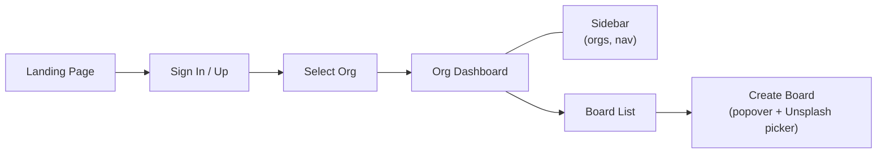
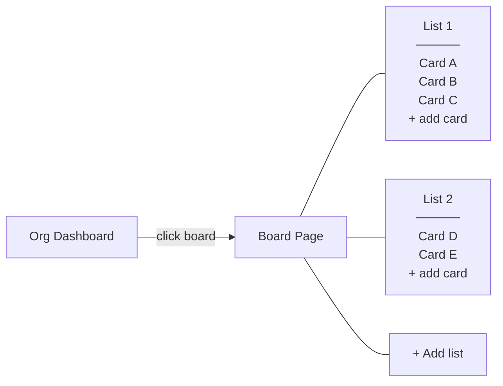
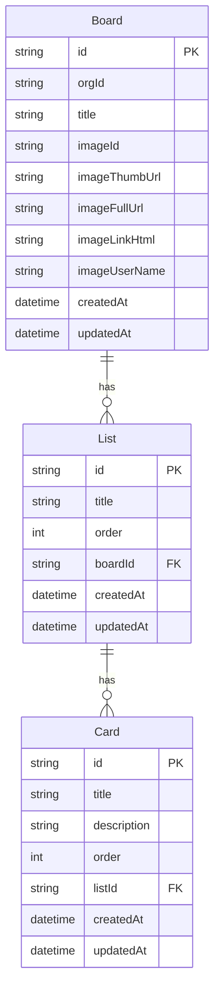
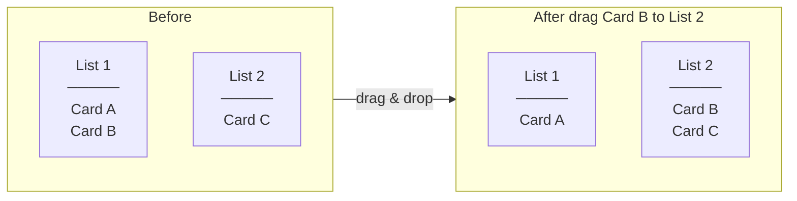
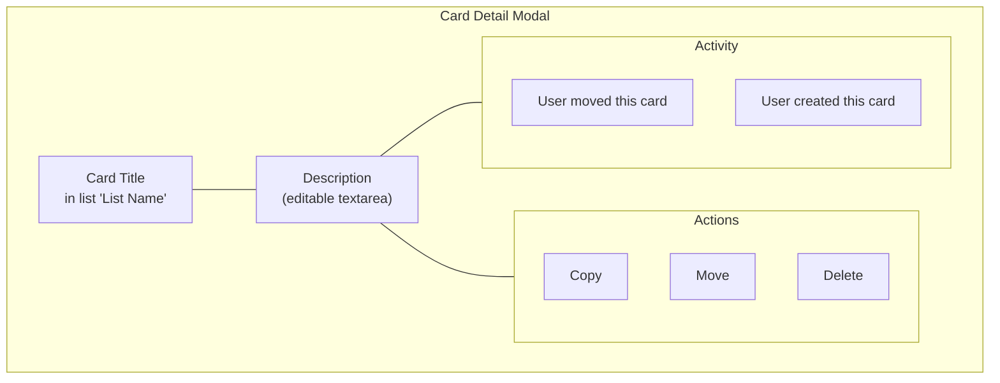
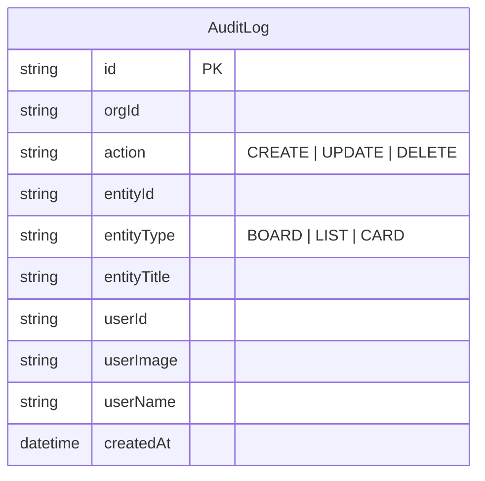
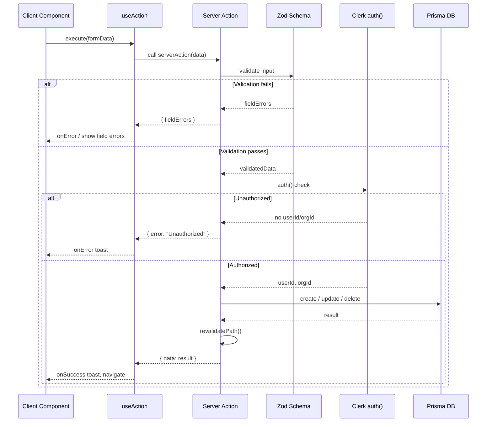
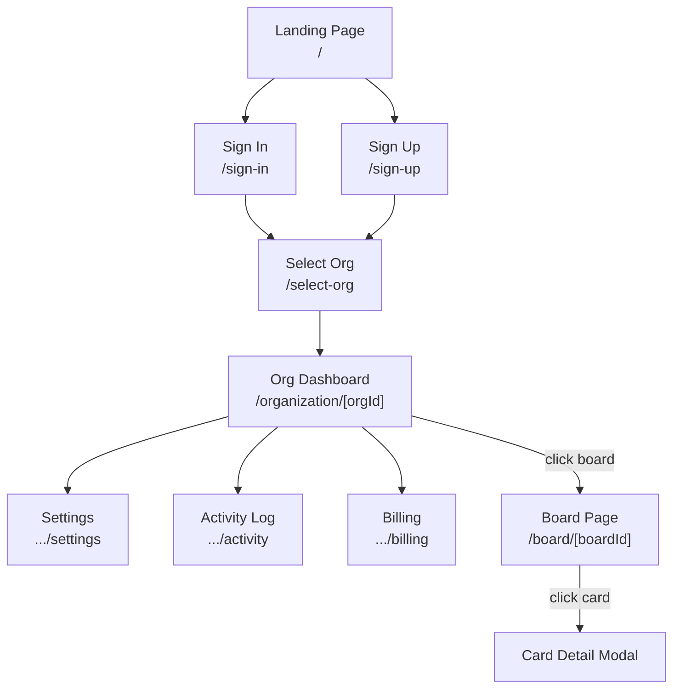

# Karta — Feature Flow & Build Roadmap

## Current state (what's done)



### Built features
- [x] Marketing landing page with CTA
- [x] Clerk auth (sign-in, sign-up, org selection)
- [x] Middleware: public routes, auth gating, org redirect
- [x] Dashboard layout: sidebar (org list + accordion nav), navbar, mobile sidebar
- [x] Org pages: dashboard, settings, activity (stub), billing (stub)
- [x] Board creation: form popover, Unsplash image picker, server action
- [x] Data model: Board (id, orgId, title, image fields, timestamps)
- [x] Server action pattern: Zod schema → safe action → useAction hook
- [x] Toast notifications (sonner)

---

## Build roadmap (what's next)

### Phase 1 — Board view (core loop)

The minimum to open a board and see something.



**Data models to add:**



**Tasks:**
- [ ] Add List and Card models to `contract.prisma`, run migration
- [ ] Board view page: `app/(platform)/(dashboard)/board/[boardId]/page.tsx`
- [ ] Board layout with background image (from Board record)
- [ ] Server actions: create-list, update-list-order, delete-list
- [ ] Server actions: create-card, update-card-order, delete-card
- [ ] List component: title, cards, "add card" form
- [ ] Card component: title, click to open detail
- [ ] Display existing boards (with images) on org dashboard board-list

### Phase 2 — Drag & drop



- [ ] Install `@hello-pangea/dnd` (maintained fork of react-beautiful-dnd)
- [ ] Drag to reorder lists horizontally
- [ ] Drag to reorder cards within a list
- [ ] Drag to move cards across lists
- [ ] Server action: `update-list-order` (batch reorder)
- [ ] Server action: `update-card-order` (batch reorder, handles cross-list moves)

### Phase 3 — Card detail modal



- [ ] Card detail modal (intercept route or dialog)
- [ ] Editable title (inline rename)
- [ ] Description editor (textarea or basic markdown)
- [ ] Server actions: update-card (title, description), delete-card, copy-card

### Phase 4 — Audit log



- [ ] Create `createAuditLog` utility (called from server actions)
- [ ] Org activity page: list recent audit entries
- [ ] Card detail modal: show card-specific activity

### Phase 5 — Board management

- [ ] Board settings: rename, delete
- [ ] Board page navbar (board title, menu)
- [ ] Copy list (duplicate list + all its cards)

### Phase 6 — Billing (optional, for completeness)

- [ ] Stripe integration (checkout, webhook, portal)
- [ ] Org subscription model / board limit (e.g. 5 free)
- [ ] Billing page: current plan, manage subscription
- [ ] Gate board creation behind limit check

### Phase 7 — Polish (optional)

- [ ] Labels on cards (colored tags)
- [ ] Due dates on cards
- [ ] Checklists inside cards
- [ ] Search / filter cards
- [ ] Keyboard shortcuts
- [ ] Responsive improvements

---

## Server action naming convention

Each action gets its own directory under `actions/`:

```
actions/
  create-board/        # schema.ts, index.ts, types.ts
  create-list/
  update-list-order/
  delete-list/
  create-card/
  update-card/
  update-card-order/
  delete-card/
  copy-card/
  copy-list/
  delete-board/
  update-board/
```

Standalone actions (no schema needed) can be single files:
```
actions/
  fetch-unsplash-images.ts
```

## Request flow



## Full app map (target)


